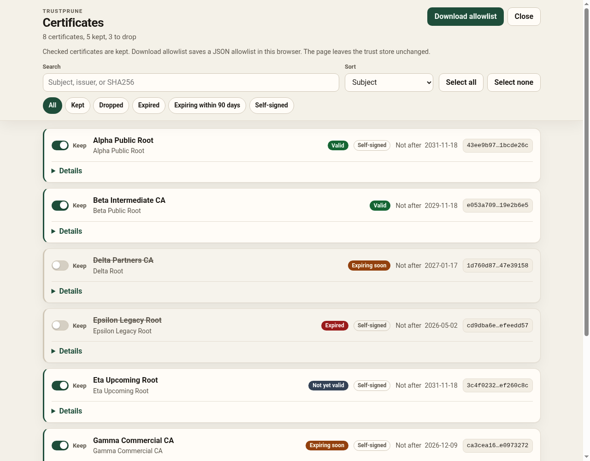

# Basics
{: .no_toc }

<details open markdown="block">
  <summary>Table of contents</summary>
  {: .text-delta }
1. TOC
{:toc}
</details>

Subcommands other than `connect`, `chain`, and `diff` accept only flags. `connect` accepts one URL. `chain` accepts one target: an existing regular file, or a host or URL. `diff` accepts exactly two certificate paths. An unexpected positional argument is rejected with exit status 2 before any write. Flags after a positional argument are still parsed, so a stray extra argument with `--dry-run` after it is still a usage error. A shell glob that expands into multiple files can cause that.

## Add

`trustprune` can add certificates into a given trust store with the `add` sub command.

```
$ trustprune add --file cert.pem

$ trustprune add --file cert.pem --app java

$ trustprune add --file cert.pem --app certifi --store /path/to/cacert.pem
```

`--file` is the certificate to import. `--store` selects a Java keystore or a certifi `cacert.pem`. `--store` alone is not the certificate file.

## Connect

The `connect` command verifies connectivity with a remote host using the certificates from a given store. Use it to check that an allowlist or a restore still reaches a host you care about.

A bare host is accepted and treated as `https`. `trustprune connect google.com` is the same target as `trustprune connect https://google.com`. An explicit `http://` URL is rejected.

Success (the default `text` format) prints one line. `sha256` is the first 16 hex characters of the root certificate. `leaf-expires` is the leaf `NotAfter` date in UTC.

```
$ ./trustprune connect google.com
ok https://google.com tls1.3 root=<name> sha256=<16 hex> leaf-expires=<YYYY-MM-DD>

$ ./trustprune connect -v google.com
ok https://google.com tls1.3 root=<name> sha256=<16 hex> leaf-expires=<YYYY-MM-DD>
INDEX  SUBJECT  ISSUER  NOT-AFTER   SHA256  LABELS
...

$ ./trustprune connect --format json google.com
{
  "url": "https://google.com",
  "tls_version": "tls1.3",
  "verified": true,
  "root": {"subject": "<name>", "sha256": "<64 hex>"},
  "leaf": {"subject": "<leaf>", "not_after": "<RFC 3339 UTC>"},
  "chain": [
    {"subject": "<leaf>", "issuer": "<issuer>", "not_after": "<RFC 3339 UTC>", "sha256": "<64 hex>"}
  ]
}

$ ./trustprune connect --app java https://google.com
ok https://google.com tls1.3 root=<name> sha256=<16 hex> leaf-expires=<YYYY-MM-DD>

$ ./trustprune connect --app java --store /path/to/cacerts https://google.com
ok https://google.com tls1.3 root=<name> sha256=<16 hex> leaf-expires=<YYYY-MM-DD>

$ ./trustprune connect --url https://google.com
ok https://google.com tls1.3 root=<name> sha256=<16 hex> leaf-expires=<YYYY-MM-DD>
```

`-v` prints the verified chain (leaf first) after the summary. Columns are INDEX, SUBJECT, ISSUER, NOT-AFTER, the 16-character SHA-256 prefix, and LABELS. LABELS is `-` on a verified chain. `--format json` prints one object and ignores `-v`. SHA-256 values in JSON are the full hex fingerprint. `verified` is true. `chain` is the verified chain, leaf first, through the trust anchor. `not_after` is UTC RFC 3339. Text `leaf-expires` and the table `NOT-AFTER` column stay `YYYY-MM-DD`.

A handshake failure is one short line, and the exit status stays 1:

```
ERROR: https://expired.badssl.com: certificate expired 2015-04-12
```

`-v` also prints the chain the server presented when verification fails. LABELS is `not in store` when that certificate is missing from the selected store, and `-` when it is in the store. The add/allowlist hint is printed only when verification fails with an unknown authority. It names `trustprune add --file` and, after the CA is in the store, the full SHA-256 to put under `fingerprints` in an allowlist file. An expired site certificate gets a short note that adding a root won't help. `--format json` on that failure adds `presented_chain` (`subject`, `issuer`, `not_after`, `sha256`, `in_store`) and sets `verified` to false. `-v` does not change JSON, and JSON does not include the text hint.

An unknown `--format` is a usage error (exit 2) and names the valid formats (`json`, `text`).

| Flag | Meaning |
|------|---------|
| `--app <name>` | Use that application's certificates for the TLS handshake |
| `--store <path>` | With `--app java` or `--app certifi`: load that store instead of discovery (same override as `list` / `backup` / `restore`) |
| `--url <url>` | URL or bare host to connect to, instead of the positional argument |
| `-v`, `--verbose` | Print the verified chain after the one-line summary. No effect with `--format json` |
| `--format` | `text` (default) is the one-line summary. `json` is one object (`url`, `tls_version`, `verified`, `root`, `leaf`, `chain`) |

## Chain

The `chain` command prints the certificate chain for a local file or a URL. The selected store is only listed. Use it to see which CA a leaf chains to, including a private CA with `--untrusted`.

Pass the target as `--file`, `--url`, or one positional argument. An existing regular file is read like `--file`. Anything else is a host or URL, like `--url` (a bare host is `https`). `--url` implies `--remote`. A positional URL still needs `--remote` to dial.

```
$ trustprune chain --file leaf.pem --app openssl --bundle /path/to/ca-bundle.pem
$ trustprune chain leaf.pem --app openssl --bundle /path/to/ca-bundle.pem
INDEX  SUBJECT       ISSUER      NOT-AFTER   SHA256    LABELS
0      leaf.example  ca.example  2027-06-01  <16 hex>  -
1      ca.example    ca.example  2027-06-01  <16 hex>  -

$ trustprune chain --file leaf.pem --untrusted
$ trustprune chain --file leaf.pem --all
$ trustprune chain --url example.com
$ trustprune chain example.com --remote
```

The default table matches `connect -v`: INDEX, SUBJECT, ISSUER, NOT-AFTER, the 16-character SHA-256 prefix, and LABELS. LABELS is `-` when none apply. Several labels are comma-separated with no spaces. `-v` / `--verbose` prints the full 64-character SHA-256 in that table. JSON always uses the full fingerprint. The leaf is shown even when it is not in the store. On a `--remote` lookup, intermediates the server presents are included when they chain to a trusted root, and are not labeled `untrusted`. `--untrusted`, `--expired`, and `--revoked` include those certificates and put `untrusted`, `expired`, `not yet valid`, or `blocklisted` in LABELS. `--expired` also includes a certificate that is not yet valid (`NotBefore` in the future) and labels it `not yet valid`. `--revoked` uses the offline Chromium, Mozilla, Apple, and CCADB removed-CA blocklists (labeled `blocklisted`). `--all` is those three flags. `--url` implies `--remote`, which dials the URL only when no local chain is found (30s timeout). Full detail: [usage](usage.md#chain).

An incomplete chain exits 1. Text prints a note. JSON sets `complete` to false, sets `missing_issuer` to the issuer name when no issuer was found (omitted for a cycle or a too-long chain), and sets `stopped_at` to the last certificate found. The note is not in the JSON. The report has no `ERROR:` prefix. A complete chain exits 0.

## Diff

`diff` compares two certificate files. There is no network access. PEM comments and other PEM block types are ignored. DER is one certificate. A file with no certificate is an error.

When both files contain one certificate, diff prints the fields that differ.

```
$ trustprune diff old.pem new.pem
subject: "CN=Old" != "CN=New"
sha256: "<64 hex>" != "<64 hex>"

$ trustprune diff --format json old.pem new.der
```

When either file contains more than one certificate, diff compares the bundles by SHA-256 fingerprint. Certificates only in the first file are removed. Certificates only in the second file are added. Duplicates in one file count once.

```
$ trustprune diff backup.pem live.pem
- <64 hex> Old CA
+ <64 hex> New CA
removed 1 added 1 unchanged 2
```

`-` is a certificate only in the first file. `+` is a certificate only in the second file. Each line is the SHA-256 fingerprint, then the subject. Removed lines come first. The last line is `removed N added N unchanged N`. Identical bundles print `identical`, the same word one certificate uses. `-v` prints `left:` and `right:` paths before that bundle text.

Exit status is 0 when the certificates match (`identical`) and 1 when they differ. The report has no `ERROR:` prefix. Unreadable files and files with no certificate exit 1 with `ERROR:` on stdout. The wrong number of paths, or an unknown `--format`, exits 2.

Compared fields for a single certificate are subject, issuer, serial, validity, key type and size, SANs, the SHA-256 fingerprint, and the signature algorithm. Full detail: [usage](usage.md#diff).

## List

The cli sub-command `list` will output a list of certificates installed (and trusted) in the certificate store. This option defaults to the platform (Linux, OSX, or Windows), but can be switched to an application via the `--app` flag. `--out <path>` writes that formatted output to a file for every format and for `--count`. Stdout stays empty.

Show certificates installed in the platform. The default format is a table with uppercase headers SUBJECT, ISSUER, KEY, DAYS, and SHA256-FINGERPRINT (16-character preview). Each column is as wide as its longest header or cell, and columns are separated by two spaces. SUBJECT and ISSUER are capped at 40 characters and end with `…` when cut; ISSUER shows `=` when the full issuer name matches the subject (self-signed roots). DAYS shows `expired` when the certificate is past `NotAfter`, `N!` when fewer than 90 days remain, and the plain day count otherwise. Every list format, including this table, uses the same order: subject (case-insensitive), then SHA-256 fingerprint.

```
$ trustprune list
SUBJECT                                   ISSUER  KEY        DAYS  SHA256-FINGERPRINT
EE Certification Centre Root CA           =       RSA-2048   1811  3e84ba4342908516
Entrust Root Certification Authority      =       RSA-2048   330   73c176434f1bc6d5
Entrust Root Certification Authority - …  =       ECDSA-384  4369  02ed0eb28c14da45
...
```

`-v` / `--verbose` applies to that default table. It shows the full fingerprint, serial, source or store path (the URL for `list --url`, with userinfo redacted), and the dates. DAYS stays numeric. When every row has the same path, the table omits the PATH column and prints `PATH: <path>` on the line above. When paths differ, PATH stays a column. Other verbose headers are SHA256-FINGERPRINT, SERIAL, NOT-BEFORE, and NOT-AFTER. The same flag is accepted globally (`trustprune -v list`).

```
$ trustprune list -v
PATH: testdata/lots.crt
SUBJECT                                   ISSUER  KEY        DAYS  SHA256-FINGERPRINT                                                SERIAL                                   NOT-BEFORE  NOT-AFTER
EE Certification Centre Root CA           =       RSA-2048   1811  3e84ba4342908516e77573c0992f0979ca084e4685681ff195ccba8a229b8a76  112324828676200291871926431888494945866  2010-10-30  2030-12-17
...
```

`--format long` prints each certificate as a multi-line dump. Empty optional fields stay hidden. `NotBefore` and `NotAfter` are UTC RFC3339, each on its own line.

```
$ trustprune list --format long
Certificate
  SHA256 Fingerprint: 6dc47172e01cbcb0bf62580d895fe2b8ac9ad4f873801e0c10b9c837d21eb177
  SerialNumber: 946069240
  Subject: Entrust.net Certification Authority (2048)
  Issuer: Entrust.net Certification Authority (2048)
  NotBefore: 1999-12-24T17:50:51Z
  NotAfter: 2029-07-24T14:15:12Z
  KEY: RSA-2048
  DAYS: 1300
  IsCA: true
...
```

Show certificates installed for an application. The same default table is used.

```
$ trustprune list --app firefox
```

Point `--store` at a venv certifi bundle or a Java keystore:

```
$ trustprune list --app certifi --store /path/to/venv/.../cacert.pem
$ trustprune list --app java --store /path/to/cacerts
```

Without `--app`, `--file` lists certificates from a PEM file (`trustprune list --file lots.crt`). `--file` cannot be combined with `--app`; use `--store` to override a java or certifi path.

If openssl is installed you can output certificates in that format (via `--format openssl`).

```
$ trustprune list --app firefox --format openssl
Certificate:
    Data:
        Version: 3 (0x2)
        Serial Number:
            f0:1d:4b:ee:7b:7c:a3:7b:3c:05:66:ac:05:97:24:58
        Signature Algorithm: sha384WithRSAEncryption
        Issuer: C=GB, ST=Greater Manchester, L=Salford, O=COMODO CA Limited, CN=COMODO RSA Certification Authority
        Validity
            Not Before: May 18 00:00:00 2015 GMT
            Not After : May 17 23:59:59 2025 GMT
        Subject: C=US, ST=TX, L=Houston, O=cPanel, Inc., CN=cPanel, Inc. Certification Authority
        Subject Public Key Info:
            Public Key Algorithm: rsaEncryption
            RSA Public Key: (2048 bit)
                Modulus (2048 bit):
                    00:8b:5e:01:56:b9:ec:6b:11:ef:48:e9:43:9e:9b:
                    ...
                Exponent: 65537 (0x10001)
        X509v3 extensions:
            X509v3 Authority Key Identifier:
                keyid:BB:AF:7E:02:3D:FA:A6:F1:3C:84:8E:AD:EE:38:98:EC:D9:32:32:D4

            X509v3 Subject Key Identifier:
                7E:03:5A:65:41:6B:A7:7E:0A:E1:B8:9D:08:EA:1D:8E:1D:6A:C7:65
            X509v3 Key Usage: critical
                Digital Signature, Certificate Sign, CRL Sign
            X509v3 Basic Constraints: critical
                CA:TRUE, pathlen:0
            X509v3 Extended Key Usage:
                TLS Web Server Authentication, TLS Web Client Authentication
            X509v3 Certificate Policies:
                Policy: 1.3.6.1.4.1.6449.1.2.2.52
                Policy: 2.23.140.1.2.1

            X509v3 CRL Distribution Points:
                URI:http://crl.comodoca.com/COMODORSACertificationAuthority.crl

            Authority Information Access:
                CA Issuers - URI:http://crt.comodoca.com/COMODORSAAddTrustCA.crt
                OCSP - URI:http://ocsp.comodoca.com

    Signature Algorithm: sha384WithRSAEncryption
        10:9f:a0:60:08:81:74:a1:a0:84:78:60:4c:39:39:da:64:77:
        ...
```

### URL

`trustprune list --url` downloads a PEM or DER certificate bundle from the URL and lists those certificates. It does not look up a live site. Mozilla [certdata.txt](https://wiki.mozilla.org/CA/Included_Certificates) is also accepted. Output uses the same formats as any other list (table by default). To see a site's certificate chain, run `trustprune chain <host> --remote`.

```
$ trustprune list --url https://raw.githubusercontent.com/mozilla-firefox/firefox/main/security/nss/lib/ckfw/builtins/certdata.txt --format long
Certificate
  SHA256 Fingerprint: 1793927a0614549789adce2f8f34f7f0b66d0f3ae3a3b84d21ec15dbba4fadc7
  SerialNumber: 41578283867086692638256921589707938090
  Subject: COMODO ECC Certification Authority
  Issuer: COMODO ECC Certification Authority
  NotBefore: 2008-03-06T00:00:00Z
  NotAfter: 2038-01-18T23:59:59Z
  IsCA: true
...
```

### TLS observatory

`trustprune` supports `--format observatory` which outputs certificates in a format supported by [nabla-c0d3/trust_stores_observatory](https://github.com/nabla-c0d3/trust_stores_observatory).

```
$ trustprune list --format observatory --app chrome
platform: Darwin (OSX)
version: 10.13.3
url: ""
date_fetched: 2018-02-13
trusted_certificates_count: 176
trusted_certificates:
- subject_name: AffirmTrust
  fingerprint: 0376ab1d54c5f9803ce4b2e201a0ee7eef7b57b636e8a93c9b8d4860c96f5fa7
...
```

`--out <path>` writes this report to a file. The same flag writes `table`, `long`, `json`, `openssl`, and `--count` output to a file. Stdout stays empty.

```
$ trustprune list --format observatory --out report.yaml
$ trustprune list --format json --out certs.json
```

### Web

`trustprune` can present certificates on a local web page with `--ui web` on `list` only (other commands ignore `--ui`). It prints the local URL (and still serves it) when a browser cannot be opened, such as on a headless host. The sticky header shows how many certificates are kept or dropped, a search box, filters (kept, dropped, expired, expiring within 90 days, self-signed), and sort. Each row shows the subject, issuer, a validity badge, the expiry date, a short SHA256 fingerprint, and a keep switch. Serial, NotBefore, NotAfter, the full fingerprint, and the formatted dump stay behind Details. Download allowlist writes a JSON allowlist of the checked fingerprints. The page does not change the trust store.

```
$ trustprune list --app java --ui web
Web UI: http://127.0.0.1:12345/
```



## Create

`create` writes a PEM bundle or a Java truststore of the trusted certificates that match an allowlist. It reads the platform store, or an application store with the same `--app`, `--store`, and `--bundle` rules as `list`. The store is left unchanged. Guide-only apps return their existing guide error and write nothing.

```
$ trustprune create --file allowlist.yaml --out ca-bundle.pem
$ trustprune create --file allowlist.yaml --format jks --out trusted.jks
$ trustprune create --file allowlist.yaml --app openssl --bundle /path/to/ca-bundle.pem --out kept.pem
```

`--format` accepts `pem` (the default), `jks`, or `pkcs12`. Omit `--out` and the PEM is written to stdout. `jks` and `pkcs12` require `--out`. `keytool` writes the truststore (password defaults to `changeit`; override with `TRUSTPRUNE_JAVA_STOREPASS`). The output file mode is `0644`. An allowlist that matches nothing fails before any output file is created. Full flags: [usage](usage.md#create).

## Backup and Restore

It's important to be able to rollback changes to your certificate store. These changes can be dangerous if done incorrectly as many websites you visit might partially quit loading.

To capture a backup:

```
$ trustprune backup
Backup completed successfully: /home/you/.trustprune/linux/1513034181

$ trustprune backup --app java
Backup completed successfully: /home/you/.trustprune/java/cacerts-1513034181.bck
```

Backups can be used as restore points.

```
# Restore from the latest backup
$ trustprune restore --app chrome

# Java / certifi: --store is the store to restore into (same as backup/list).
$ trustprune restore --app java --store /path/to/cacerts
$ trustprune restore --app certifi --store /path/to/venv/.../cacert.pem

# Explicit backup path
$ trustprune restore --backup /path/to/backup
```
